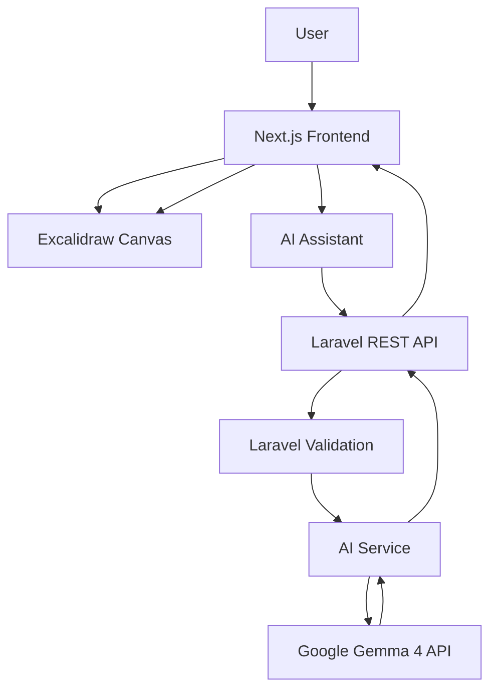

# CanvasMind — Product Requirements & Technical Handoff

**Project:** CanvasMind  
**Category:** AI-Powered Visual Diagram Editor  
**Frontend:** Next.js + TypeScript + Tailwind CSS  
**Backend & AI:** Laravel + Google Gemma 4 API  
**Canvas Engine:** Excalidraw  
**Icons:** Font Awesome  
**Database:** Not required  
**Authentication:** Not required  
**Development:** Two independent devices / two development teams  
**Target Development Time:** 4 hours

---

# PART I — PROJECT REQUIREMENTS

## 1. Project Overview

CanvasMind is an AI-powered visual diagram editor designed for programmers and software engineers.

The application enables users to create, edit, and reconstruct technical diagrams through manual interaction, natural language instructions, and image uploads.

CanvasMind combines Excalidraw's existing canvas capabilities with Google Gemma 4 to provide AI-assisted diagram generation and modification.

The application has three primary functionalities:

1. AI Automatic Editing.
2. Manual Editing.
3. Image-to-Diagram.

The project uses a decoupled architecture:

- Next.js handles the entire frontend.
- Laravel handles REST API requests and AI orchestration.
- Google Gemma 4 handles text and image understanding.
- Excalidraw provides the canvas engine.

The frontend and backend must communicate exclusively through the agreed API contract.

## 2. Target Users

Programmers and software engineers who need to create:

- System architecture diagrams.
- Flowcharts.
- UML / Class diagrams.
- Database ERDs.
- Sequence diagrams.

## 3. Functional Requirements

### FR-01: AI Automatic Editing

Users can modify diagrams using natural language instructions.

Capabilities:

- Generate a diagram from a text prompt.
- Add new shapes and components.
- Modify existing shapes and labels.
- Delete elements.
- Create, update, and remove connections.
- Modify colors and other visual properties.
- Arrange diagram layouts.
- Reconstruct existing diagram structures.
- Modify selected elements or the entire canvas.

Example instructions:

- "Create a system architecture for an online shopping application."
- "Add Redis Cache between the API Server and Database."
- "Change the selected component into Authentication Service."
- "Rearrange the entire diagram to make it easier to understand."

Editing scope:

- `selected`: only modify selected elements and relevant relationships.
- `all`: consider the entire diagram and modify any relevant elements.

The backend must return validated structured actions. It must never return executable JavaScript or arbitrary code.

### FR-02: Manual Editing

Users can create and edit diagrams using Excalidraw.

Required capabilities:

- Rectangle.
- Ellipse.
- Diamond.
- Text.
- Arrow and connector.
- Freehand drawing.
- Select and move.
- Resize.
- Delete.
- Zoom and pan.
- Undo and redo.

Do not rebuild Excalidraw's drawing engine or toolbar.

Use its existing UI and adjust the surrounding application layout.

### FR-03: Image-to-Diagram

Users can upload images and convert them into editable diagrams.

Supported image types:

- Hand-drawn sketches.
- Whiteboard photographs.
- Digital diagram screenshots.
- Screenshots from diagramming applications.

Supported file formats:

- PNG.
- JPG / JPEG.

Conversion modes:

**Recreate**

Preserve the original diagram's approximate positions, visual structure, text, and connections.

**Reconstruct**

Preserve the diagram's semantic meaning while improving alignment, spacing, layout, and readability.

Workflow:

1. User uploads an image.
2. User selects the diagram type.
3. User selects Recreate or Reconstruct.
4. Frontend sends the image to Laravel.
5. Laravel sends the image and instructions to Gemma 4.
6. Gemma 4 analyzes the image and generates structured diagram data.
7. Laravel validates the result.
8. Frontend renders an editable preview.
9. User can modify the preview manually.
10. User selects one of two actions:
    - Replace: replace the main canvas.
    - Add to Canvas: append the generated elements.

The existing canvas must not be overwritten before the user confirms the action.

## 4. Supported Diagram Types

Use the following exact diagram type identifiers throughout the application:

| Display Name | Identifier |
|---|---|
| System Architecture | `system_architecture` |
| Flowchart | `flowchart` |
| UML / Class Diagram | `uml_class` |
| Database ERD | `database_erd` |
| Sequence Diagram | `sequence_diagram` |

These are diagram contexts, not separate canvas implementations.

## 5. User Interface Requirements

### 5.1 Landing Page

Provide three main entry points:

- Create with AI.
- Start from Scratch.
- Upload Image.

Users can enter the editor without authentication.

### 5.2 Canvas Editor

Use a minimalist, canvas-first layout.

Components:

- Application header.
- Excalidraw canvas.
- Existing Excalidraw toolbar.
- Floating AI assistant.
- Image upload interface.
- Export controls.

### 5.3 AI Assistant

The assistant must provide:

- Text prompt input.
- Editing scope selection or current selection context.
- Processing indicator.
- AI response summary.
- Preview of proposed changes.
- Apply and Cancel actions.

### 5.4 Image Conversion Preview

Use a separate temporary Excalidraw preview.

The user must be able to:

- Inspect generated elements.
- Modify labels and positions.
- Add or remove shapes.
- Confirm Replace or Add to Canvas.

### 5.5 Icons

Use Font Awesome exclusively for application-level icons.

For a React frontend, use:

- `@fortawesome/react-fontawesome`
- `@fortawesome/free-solid-svg-icons`
- `@fortawesome/fontawesome-svg-core`

Use appropriate icons for:

- AI assistant.
- Upload.
- Export.
- Undo and redo, if application-level controls are required.
- Create project or diagram.
- Close and confirmation actions.

Do not introduce Lucide, Heroicons, or another icon library.

Excalidraw's internal toolbar is an exception because it is part of the existing third-party editor UI. Do not modify its internal icon implementation.

---

# PART II — SYSTEM ARCHITECTURE

## 6. Technology Stack

### Frontend

| Technology | Responsibility |
|---|---|
| Next.js | Frontend framework |
| TypeScript | Type safety |
| Tailwind CSS | Styling |
| Excalidraw | Canvas engine |
| Font Awesome | Application icons |
| Fetch API | Backend communication |

### Backend & AI

| Technology | Responsibility |
|---|---|
| Laravel | Backend framework |
| PHP | Backend language |
| Laravel HTTP Client | Google API communication |
| Google Gemma 4 | Text and image understanding |
| Laravel Validation | Request validation |
| Zod is not required here | Backend validation should use Laravel validation |

### Infrastructure

- No Supabase.
- No database.
- No authentication.
- No permanent file storage.
- No user accounts.
- No collaboration.

The application operates as a temporary single-user workspace.

## 7. Architecture Overview



## 8. Development Separation

The frontend and backend must be independently runnable.

### Frontend Device

Responsible for:

- User interface.
- Excalidraw integration.
- Canvas state management.
- User interactions.
- Image selection and upload.
- API request construction.
- API response handling.
- AI preview rendering.
- Applying or cancelling changes.
- PNG, SVG, and JSON export.

### Backend & AI Device

Responsible for:

- Laravel setup.
- REST API development.
- Request validation.
- Google Gemma 4 integration.
- Prompt engineering.
- Structured AI responses.
- Image analysis.
- Action generation.
- Diagram data validation.
- Error handling.

### Shared Responsibility

Both teams must agree on the shared diagram data contract before implementation.

Neither team may independently change API fields or data types without communicating the change to the other team.

---

# PART III — SHARED DATA CONTRACT

## 9. Core Integration Principle

The frontend and backend must use a shared application-level diagram representation.

Do not use the full internal Excalidraw element structure as the primary AI communication contract.

Instead:

1. Frontend converts relevant Excalidraw objects into a normalized diagram document.
2. Frontend sends the normalized document to Laravel.
3. Laravel provides the document to Gemma 4 as structured context.
4. Gemma 4 returns validated structured data.
5. Laravel returns the agreed response format.
6. Frontend converts the response into Excalidraw elements.

This prevents the backend from becoming dependent on Excalidraw's internal implementation.

## 10. Canonical Diagram Document

The following structure is the shared data contract.

```json
{
  "diagramType": "system_architecture",
  "elements": [
    {
      "id": "frontend",
      "type": "rectangle",
      "text": "Frontend",
      "x": 100,
      "y": 100,
      "width": 160,
      "height": 80,
      "style": {
        "backgroundColor": "#dbeafe",
        "strokeColor": "#2563eb"
      }
    },
    {
      "id": "api-server",
      "type": "rectangle",
      "text": "API Server",
      "x": 100,
      "y": 250,
      "width": 160,
      "height": 80,
      "style": {
        "backgroundColor": "#dcfce7",
        "strokeColor": "#16a34a"
      }
    }
  ],
  "connections": [
    {
      "id": "frontend-api",
      "from": "frontend",
      "to": "api-server",
      "label": "HTTP Request"
    }
  ]
}
```

### 10.1 Diagram Element Fields

| Field | Type | Required | Description |
|---|---|---|---|
| `id` | string | Yes | Unique element identifier |
| `type` | string | Yes | Shape type |
| `text` | string | Yes | Element label; can be empty |
| `x` | number | Yes | Horizontal position |
| `y` | number | Yes | Vertical position |
| `width` | number | Yes | Element width |
| `height` | number | Yes | Element height |
| `style` | object | No | Visual properties |

Allowed shape types:

- `rectangle`
- `ellipse`
- `diamond`
- `text`

### 10.2 Style Fields

| Field | Type |
|---|---|
| `backgroundColor` | string |
| `strokeColor` | string |

Optional visual properties can be introduced later if needed.

### 10.3 Connection Fields

| Field | Type | Required |
|---|---|---|
| `id` | string | Yes |
| `from` | string | Yes |
| `to` | string | Yes |
| `label` | string | No |

A connection must reference existing element IDs.

The frontend is responsible for translating canonical connections into Excalidraw arrows and maintaining their bindings.

## 11. AI Action Contract

For AI editing, the backend returns a list of structured actions.

### Supported Actions

| Action | Description |
|---|---|
| `create_shape` | Create a new element |
| `update_shape` | Update an existing element |
| `delete_shape` | Delete an element |
| `create_connection` | Create a connection |
| `update_connection` | Modify a connection |
| `delete_connection` | Remove a connection |
| `arrange_layout` | Rearrange the diagram |

### Example

```json
{
  "summary": "Added Redis Cache between API Server and Database.",
  "actions": [
    {
      "type": "create_shape",
      "element": {
        "id": "redis-cache",
        "type": "rectangle",
        "text": "Redis Cache",
        "x": 350,
        "y": 250,
        "width": 160,
        "height": 80,
        "style": {
          "backgroundColor": "#fef3c7",
          "strokeColor": "#d97706"
        }
      }
    },
    {
      "type": "create_connection",
      "connection": {
        "id": "api-redis",
        "from": "api-server",
        "to": "redis-cache",
        "label": "Cache Request"
      }
    }
  ]
}
```

### Action Validation Rules

- Every action must use an allowed action type.
- Every referenced element must exist, except newly created elements.
- New IDs must be unique.
- A connection cannot reference a nonexistent element.
- Coordinates and dimensions must be valid numbers.
- Delete operations must reference existing elements.
- Unknown actions must be rejected.
- Model-generated code must never be executed.

The backend validates AI output. The frontend also performs basic defensive validation before applying changes.

## 12. Shared API Response Envelope

All API responses must use the following convention.

### Success

```json
{
  "status": "success",
  "data": {},
  "message": "Request processed successfully"
}
```

### Error

```json
{
  "status": "error",
  "data": null,
  "message": "Unable to process request"
}
```

HTTP status codes must represent the actual request outcome.

Recommended:

- `200`: successful request.
- `400`: invalid request.
- `413`: upload too large.
- `422`: validation failure.
- `429`: rate limit.
- `500`: internal server error.
- `502`: AI provider failure.

---

# PART IV — BACKEND API SPECIFICATION

## 13. API Base URL

All API endpoints must use:

`/api/v1`

During local development, the frontend should configure:

```env
NEXT_PUBLIC_API_URL=http://BACKEND_HOST:8000/api/v1
```

The actual backend host must be provided by the backend developer.

Do not hardcode `localhost` when the frontend and backend run on different devices.

## 14. API Endpoints

| Method | Endpoint | Purpose |
|---|---|---|
| GET | `/health` | Backend health check |
| POST | `/ai/edit` | Generate AI editing actions |
| POST | `/ai/image-to-diagram` | Convert uploaded images |

No authentication middleware is required.

## 15. AI Edit Endpoint

`POST /api/v1/ai/edit`

### Request

```json
{
  "prompt": "Add Redis Cache between API Server and Database.",
  "diagramType": "system_architecture",
  "scope": "all",
  "selectedElementIds": [],
  "diagram": {
    "elements": [],
    "connections": []
  }
}
```

### Fields

| Field | Type | Required |
|---|---|---|
| `prompt` | string | Yes |
| `diagramType` | string | Yes |
| `scope` | string | Yes |
| `selectedElementIds` | array of strings | Yes |
| `diagram.elements` | array | Yes |
| `diagram.connections` | array | Yes |

Allowed scope:

- `selected`
- `all`

When scope is `selected`, selected IDs must be included.

When scope is `all`, the backend receives the complete normalized diagram.

### Success Response

```json
{
  "status": "success",
  "data": {
    "summary": "Redis Cache was added between API Server and Database.",
    "actions": [
      {
        "type": "create_shape",
        "element": {
          "id": "redis-cache",
          "type": "rectangle",
          "text": "Redis Cache",
          "x": 350,
          "y": 250,
          "width": 160,
          "height": 80,
          "style": {
            "backgroundColor": "#fef3c7",
            "strokeColor": "#d97706"
          }
        }
      }
    ]
  },
  "message": "AI editing actions generated successfully"
}
```

The backend generates proposed actions only. The frontend is responsible for previewing and applying them.

## 16. Image-to-Diagram Endpoint

`POST /api/v1/ai/image-to-diagram`

Content-Type:

`multipart/form-data`

### Request Fields

| Field | Type | Required |
|---|---|---|
| `image` | file | Yes |
| `mode` | string | Yes |
| `diagramType` | string | Yes |

Allowed mode:

- `recreate`
- `reconstruct`

### Success Response

```json
{
  "status": "success",
  "data": {
    "summary": "Diagram successfully reconstructed.",
    "diagram": {
      "elements": [],
      "connections": []
    }
  },
  "message": "Image converted successfully"
}
```

The returned diagram is a temporary preview. The backend does not directly modify the main canvas.

The frontend handles Replace and Add to Canvas operations.

## 17. Health Endpoint

`GET /api/v1/health`

Response:

```json
{
  "status": "success",
  "data": {
    "service": "CanvasMind API",
    "available": true
  },
  "message": "API is running"
}
```

---

# PART V — FRONTEND IMPLEMENTATION TASKS

## 18. Frontend Responsibilities

The frontend developer owns all browser-side functionality.

### Task FE-01: Project Setup

- Initialize Next.js with TypeScript.
- Configure Tailwind CSS.
- Install Excalidraw.
- Install Font Awesome packages.
- Configure environment variables.
- Implement the shared API client.

### Task FE-02: Landing Page

Implement:

- Create with AI.
- Start from Scratch.
- Upload Image.

No login or registration pages.

### Task FE-03: Canvas Integration

- Integrate Excalidraw as a client-side component.
- Capture the Excalidraw imperative API.
- Maintain the current canvas scene.
- Read selected element IDs.
- Convert canvas elements into the canonical diagram document.
- Convert canonical diagram data back into Excalidraw elements.
- Preserve IDs and connection relationships.

### Task FE-04: Manual Editing

Use the existing Excalidraw functionality.

Do not recreate its toolbar.

Ensure that manual editing updates the current canvas state correctly.

### Task FE-05: AI Assistant

- Build a floating AI panel.
- Collect user instructions.
- Determine editing scope.
- Collect selected element IDs.
- Serialize the current diagram.
- Send the request to `/ai/edit`.
- Display the returned summary and actions.
- Generate a temporary preview.
- Provide Apply and Cancel.

### Task FE-06: Image-to-Diagram

- Implement image upload.
- Validate PNG and JPG/JPEG.
- Provide Recreate and Reconstruct options.
- Select a diagram category.
- Send multipart/form-data.
- Render returned diagram data in a temporary preview.
- Allow preview editing.
- Provide Replace and Add to Canvas.
- Do not overwrite the main canvas before confirmation.

### Task FE-07: Export

Provide:

- PNG export.
- SVG export.
- JSON export.

Use Excalidraw's existing export utilities.

### Task FE-08: Error Handling

Handle:

- Backend unavailable.
- Network failure.
- Invalid AI response.
- Image upload errors.
- Empty canvas.
- Missing selected elements.
- Invalid diagram references.

### Task FE-09: Integration Testing

Test with the actual backend API.

The frontend must not rely on hardcoded mock responses in the final integrated application.

---

# PART VI — BACKEND & AI IMPLEMENTATION TASKS

## 19. Backend & AI Responsibilities

The backend and AI developer owns Laravel, API contracts, AI integration, and structured response generation.

### Task BEAI-01: Laravel Setup

- Initialize Laravel.
- Configure environment variables.
- Configure API routes.
- Configure CORS for the frontend development origin.
- Implement API response convention.
- Implement health endpoint.

### Task BEAI-02: Request Validation

Implement Laravel validation for:

- AI edit requests.
- Diagram types.
- Editing scope.
- Selected element IDs.
- Diagram elements.
- Connections.
- Uploaded image type and size.
- Image conversion mode.

### Task BEAI-03: Gemma 4 Integration

- Configure Google API credentials.
- Verify the actual model identifier.
- Verify text and image input support.
- Implement the AI service.
- Handle provider failures and timeouts.
- Keep credentials server-side.

### Task BEAI-04: AI Automatic Editing

- Build the system prompt.
- Pass the diagram context.
- Pass selected-element context.
- Generate structured actions.
- Parse the model response.
- Validate action types and references.
- Return the agreed JSON response.

### Task BEAI-05: Image-to-Diagram

- Receive multipart image uploads.
- Validate image content.
- Send the image to Gemma 4.
- Provide diagram-specific extraction instructions.
- Implement Recreate and Reconstruct modes.
- Convert model output into the canonical diagram document.
- Validate the output.
- Return the preview data.

### Task BEAI-06: Error Handling

Handle:

- Invalid API key.
- Unsupported model.
- Provider timeout.
- Rate limits.
- Invalid model response.
- Malformed JSON.
- Invalid element IDs.
- Unsupported image formats.

### Task BEAI-07: API Testing

Use Postman, Bruno, or another HTTP client to test all endpoints.

Provide request and response examples to the frontend developer.

---

# PART VII — INTEGRATION RULES

## 20. Development on Two Different Devices

The two teams must not depend on shared localhost environments.

### Frontend Device

Runs the Next.js application on its local network interface.

Example:

`http://192.168.1.10:3000`

### Backend Device

Runs Laravel on its local network interface.

Example:

`http://192.168.1.20:8000`

The addresses are illustrative. Replace them with actual device IP addresses.

### Backend CORS

Laravel must allow the actual frontend development origin.

Example:

```php
// config/cors.php

'allowed_origins' => [
    'http://192.168.1.10:3000',
],
```

The Laravel server must listen on an address accessible from the frontend device, not only `127.0.0.1`.

### Frontend Environment

```env
NEXT_PUBLIC_API_URL=http://192.168.1.20:8000/api/v1
```

Do not use `localhost` for cross-device communication.

## 21. Contract-First Development

Before implementation, both developers must agree on:

1. API endpoint names.
2. Request field names.
3. Response field names.
4. Diagram element schema.
5. Connection schema.
6. Action schema.
7. Error response structure.
8. Supported diagram type identifiers.

The frontend can use temporary mock responses matching the exact contract while the backend is still being implemented.

The backend must provide real responses matching the same contract.

Do not allow either side to introduce undocumented field changes.

## 22. Excalidraw Integration Boundary

The frontend owns all Excalidraw-specific operations.

The backend must not:

- Import Excalidraw packages.
- Generate internal Excalidraw element metadata.
- Modify the browser canvas.
- Apply actions directly to the canvas.
- Depend on frontend component implementations.

The backend only processes normalized diagram data and returns normalized results.

The frontend translates normalized results into Excalidraw elements.

This separation is mandatory.

---

# PART VIII — DEVELOPMENT SCHEDULE

## 23. Four-Hour Schedule

Both developers work in parallel.

| Time | Frontend | Backend & AI |
|---|---|---|
| 00:00–00:20 | Setup Next.js and dependencies | Setup Laravel and API |
| 00:20–00:45 | Integrate Excalidraw and basic layout | Implement health and validation |
| 00:45–01:25 | Implement API client and AI panel | Integrate Gemma 4 |
| 01:25–02:10 | Implement AI preview and apply | Implement AI editing endpoint |
| 02:10–02:50 | Implement image upload and preview | Implement image-to-diagram |
| 02:50–03:15 | Implement export and integration | Fix AI responses and validation |
| 03:15–03:35 | Integration testing | Integration testing |
| 03:35–04:00 | Demo preparation | Demo preparation |

## 24. Priority

### Must Have

- Working Excalidraw canvas.
- Manual editing.
- AI text-to-diagram.
- AI editing of an existing diagram.
- Image upload.
- At least one working image conversion mode.
- Preview and Apply.
- Basic export.

### Should Have

- Both image conversion modes.
- Replace and Add to Canvas.
- Selected-element editing.
- All five diagram types.
- PNG, SVG, and JSON exports.

### Could Have

- Advanced layout optimization.
- Sophisticated UML generation.
- Complex sequence diagrams.
- Advanced diagram analysis.

---

# PART IX — ACCEPTANCE CRITERIA

## 25. Definition of Done

### Frontend

- [ ] Application loads without authentication.
- [ ] Landing page provides three entry points.
- [ ] Excalidraw is integrated.
- [ ] Manual drawing works.
- [ ] AI Assistant can submit prompts.
- [ ] Current diagram is serialized correctly.
- [ ] Selected element IDs are passed correctly.
- [ ] AI actions are previewed before applying.
- [ ] Image upload works.
- [ ] Image preview can be edited.
- [ ] Replace and Add to Canvas work.
- [ ] PNG, SVG, and JSON export work.

### Backend & AI

- [ ] Laravel API is accessible from the frontend device.
- [ ] Health endpoint works.
- [ ] AI edit endpoint accepts the agreed request schema.
- [ ] Gemma 4 generates structured actions.
- [ ] Actions are validated.
- [ ] Image endpoint accepts PNG and JPG.
- [ ] Both conversion modes are supported.
- [ ] AI returns the agreed diagram document.
- [ ] Errors follow the shared response envelope.
- [ ] API credentials remain server-side.

### Integration

- [ ] Frontend and backend communicate across two devices.
- [ ] No undocumented API fields are used.
- [ ] Diagram IDs remain consistent.
- [ ] Connections reference valid elements.
- [ ] Main canvas remains unchanged until Apply.
- [ ] All three primary functionalities can be demonstrated.

---

# PART X — FINAL IMPLEMENTATION PRINCIPLES

1. Prioritize working functionality over architectural complexity.
2. Use Excalidraw rather than rebuilding the canvas engine.
3. Use Font Awesome for application icons.
4. Keep frontend and backend independent.
5. Use the shared canonical diagram schema.
6. Do not pass raw Excalidraw internal metadata to Gemma 4.
7. Do not execute model-generated code.
8. Validate all AI output.
9. Keep the main canvas unchanged until the user confirms changes.
10. Do not implement authentication, database, or persistent storage.
11. Keep the API contract stable during parallel development.
12. Reserve time for integration testing and the demonstration video.

**Final Project Definition**

CanvasMind is a single-user AI-powered visual diagram editor using Next.js, Laravel, Excalidraw, and Google Gemma 4.

Its core capabilities are AI Automatic Editing, Manual Editing, and Image-to-Diagram.

The project uses a decoupled frontend/backend architecture with a shared normalized diagram data contract, allowing frontend and backend development to proceed independently on two different devices.

The primary engineering objective is to demonstrate how Gemma 4 can understand, generate, and modify technical diagrams through text and visual input.